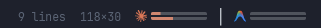
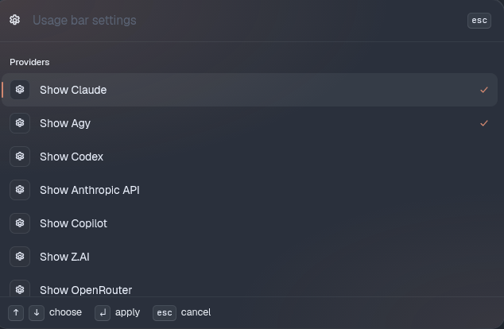

# tern-usage-sidebar

> **Archived.** Since Tern 0.9.17, the built-in widget bar covers this. It shows widgets along the window's foot, including AI usage limits, with hover details. Add them from palette › Edit widgets…. This repository is no longer maintained.

A Tern plugin that shows your AI usage limits in the status bar, using data from `ai-usagebar`.

Each provider gets a small two-line bar: the top line is the 5-hour window, the bottom line is the weekly window. Hover a bar to see the percentages and reset times.

## Screenshots




## Requirements

- Tern with plugin support and `"status_bar": true` in `settings.json`
- `ai-usagebar` on your `PATH` (`ai-usagebar usage --json` must work)

## Install

```sh
tern plugin install github.com/ak4duy/tern-usage-sidebar
```

Or from a local clone:

```sh
git clone https://github.com/ak4duy/tern-usage-sidebar.git
tern plugin link tern-usage-sidebar
```

## Usage

Open the command palette (Ctrl+Shift+P) and run:

| Command | What it does |
|---|---|
| Usage Bar: Settings | Opens the settings picker |
| Usage Bar: Refresh now | Fetches usage immediately |
| Usage Bar: Toggle … | Toggles a single setting without opening the picker |

### Settings

- **Providers**: Claude, Agy (Antigravity) and Codex are on by default. Turning a provider on also runs `ai-usagebar settings enable <id>`. Supported providers: Claude, Agy, Codex, Anthropic API, Copilot, Z.AI, OpenRouter, DeepSeek, DeepInfra, Kimi, Kilo, Novita, Synthetic, Moonshot, Grok, SuperGrok, Grok Bot, Cursor, MiniMax, Kiro, Nous, OpenCode Go, Command Code, Ollama, OrcaRouter, Model Studio, Lyceum, Devin, Muse Code and Cline.
- **Style**: bars, rings, or percent text.
- **Separators**: a `│` between providers.
- **Hover tooltips**: percentages and reset times on hover.
- **Refresh**: every 1, 2, 5, 10, 15, 30 or 60 minutes (default 5).

Providers that report a balance instead of a percentage show that balance as text.

## License

[MIT](LICENSE)
